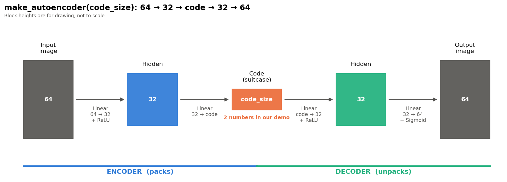

# Autoencoders, explained simply

A hands-on notebook that teaches autoencoders in short sentences and plain
Python (no classes, no jargon). It runs on a laptop in a few minutes, on a
small real dataset.



## The idea in one picture

An autoencoder is a **suitcase**. The encoder packs a big input into a
small code. The decoder unpacks the code back into the input. If the
unpacked result looks like the original, the small code kept what matters.

## Notebook

[`autoencoders_explained.ipynb`](autoencoders_explained.ipynb) covers:

- the encoder, the code, the decoder and reconstruction error;
- how code size changes quality;
- anomaly detection (train on normal data only, flag what rebuilds badly);
- denoising;
- real-world uses of autoencoders.

## Selected results

Numbers below come from the saved notebook outputs. They vary slightly
with random seed and library versions.

- **Code size** (test error for codes of 2, 4, 8 and 16 numbers):
  0.045, 0.029, 0.018, 0.014. A bigger code rebuilds better.
- **Anomaly detection** (train on non-zero digits, treat zeros as "fraud"):
  the autoencoder caught 30 of 40 zeros with 6 false alarms among normal
  digits.
- **Denoising:** difference from the clean image fell from 0.051 to 0.024.

## Run it

```bash
git clone <this-repo-url>
cd <this-repo>
python -m venv .venv
source .venv/bin/activate        # Windows: .venv\Scripts\activate
pip install -r requirements.txt
jupyter notebook
```

Needs Python 3.9+. On Apple Silicon Macs, if PyTorch complains about
duplicate OpenMP libraries, start Jupyter with:

```bash
KMP_DUPLICATE_LIB_OK=TRUE jupyter notebook
```

The notebook already contains its outputs, so you can read it on GitHub
without running anything.

## Data

The notebook uses scikit-learn's `load_digits`: 1,797 handwritten digits
as 8×8 grayscale images, written by 13 people. It is the test half of the
UCI *Optical Recognition of Handwritten Digits* dataset. No download is
needed.

> E. Alpaydin and C. Kaynak. *Optical Recognition of Handwritten Digits.*
> UCI Machine Learning Repository, 1998.
> https://doi.org/10.24432/C50P49 (CC BY 4.0)

## Project layout

```
.
├── autoencoders_explained.ipynb
├── autoencoder_architecture.png
├── requirements.txt
├── LICENSE
└── README.md
```

## License

MIT. See [LICENSE](LICENSE).
